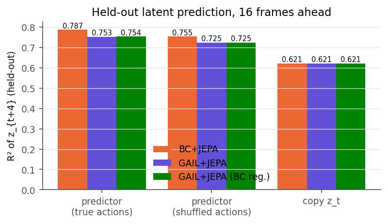
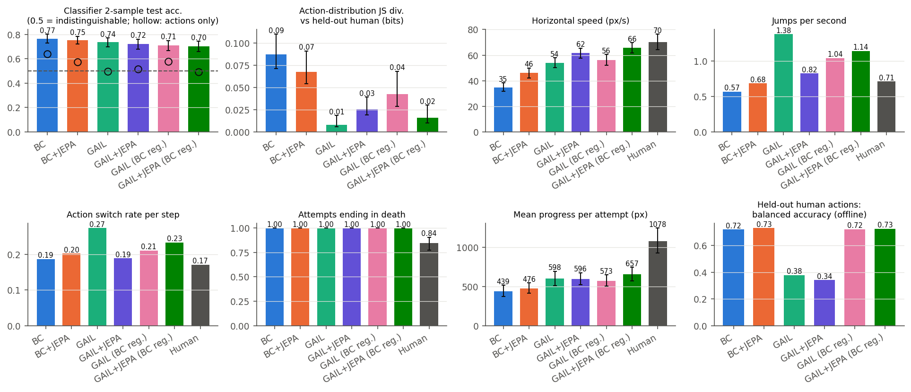
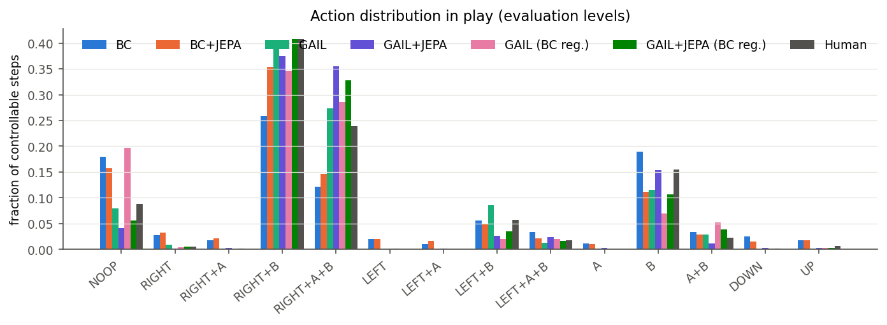
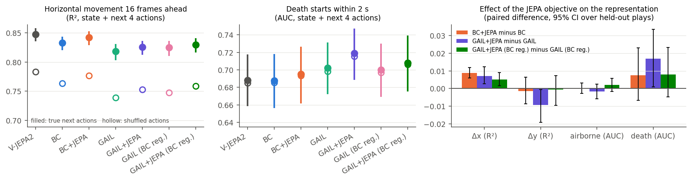
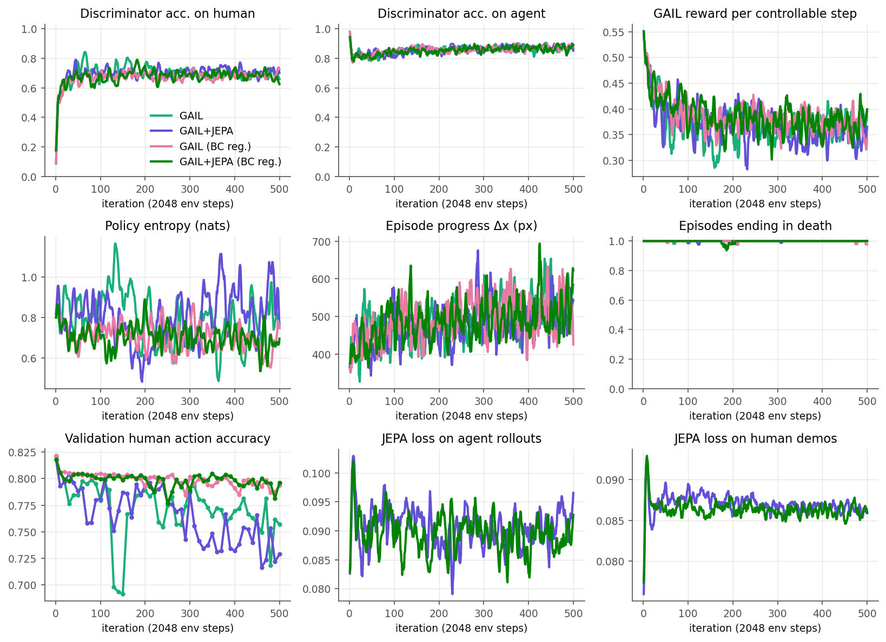
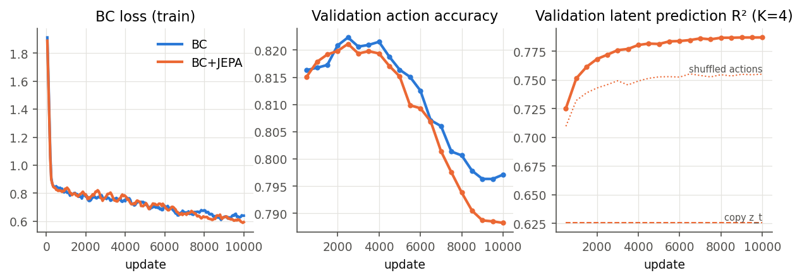

# Preliminary results: a JEPA + GAIL Mario agent trained on one human's play

Status: **prototype, one training seed per arm, one subject (sub-01).** Every number below was
computed by the scripts in this repository from the files in `results/`. Nothing is extrapolated.
Work not yet run is listed in section 9 as proposed.

## Summary in plain English

- **The agent plays the real game.** It runs in CNeuroMod's own Super Mario Bros setup, sees the
  screen through a frozen V-JEPA 2 video model, and plays levels by itself. Its games are saved as
  videos and as replay files that reproduce exactly (kept locally, see section 6).
- **Imitation works on button habits, not yet on skill.** After GAIL, a fresh classifier cannot tell
  the agent's button use from the human's (chance level). It runs at 77–93% of the human's speed. But
  every agent attempt ends in death, agents get 54–61% as far as the human, and none finishes a
  level.
- **The JEPA objective makes the shared representation keep more information about what the
  agent's actions will do.** This held in all three with/without-JEPA comparisons (BC, GAIL, GAIL with
  a BC regulariser). The effect is small but consistent.
- **JEPA agents moved more like the human's speed.** In both GAIL pairs the JEPA arm ran faster and
  closer to the human (61 vs 54 and 65 vs 55 px/s; human 70). Other behavioural differences between
  the JEPA and no-JEPA arms did not replicate across the two pairs.
- **The best agent overall is GAIL+JEPA with a small BC regulariser.** It keeps per-step agreement
  with held-out human choices at BC level (balanced accuracy 0.73) while matching the human's action
  statistics.
- **What did not work:** the policy ignores the predictor's "imagined consequences" input, so JEPA
  influences decisions only through the shared representation. All results are one training seed
  each; seeds are the first next step.

## 1. Question

Can one agent both **(a) play like a particular human** (adversarial imitation) and **(b) carry a
representation of what its actions will do** (JEPA-style latent prediction), when both objectives
train the same representation on top of a frozen video world model? The point of interest is the
interaction of the two objectives inside one agent, measured against BC-only and GAIL-only versions
of the same architecture.

## 2. What was built (completed)

- **Real emulator in the loop.** Super Mario Bros runs in stable-retro with CNeuroMod's own game
  integration (ROM sha1 `facee9c5…`, CNeuroMod level states), so the agent plays the same game, levels
  and start states as the participants.
- **Human data from the emulator, not the videos.** All 797 sub-01 plays (13.7 h) were replayed from
  their `.bk2` input logs. Replay screen *k* is pixel-aligned with recorded video frame *k*, and the
  inputs and annotations line up (see `docs/DATA.md`). Agent and human observations therefore come
  from the same renderer.
- **Frozen V-JEPA 2 ViT-L** (`facebook/vjepa2-vitl-fpc64-256`) encodes the 8 screens before every
  15 Hz decision into a 4×4×1024 latent grid. It is never trained.
- **Agent** (`docs/ARCHITECTURE.md`): a shared adapter feeding both a latent predictor and the
  policy/value heads. The predictor forecasts the frozen latent 16 frames ahead from the actions in
  between. The policy also reads the predictor's imagined outcome of every action. A separate
  discriminator scores (latent, previous action, action) as human vs agent.
- **Training:** BC warm start (± JEPA), then GAIL + PPO in 16 parallel emulators, with
  `L = L_PPO(GAIL reward) + λ·L_JEPA` in every minibatch (λ = 1). The JEPA term uses both human
  windows and the agent's own rollouts.
- **Evaluation:** held-out-session human action agreement, held-out latent prediction against copy and
  shuffled-action controls, closed-loop play on the most-played held-out levels with trajectory
  statistics against held-out human attempts, a classifier two-sample test (agent vs human), gameplay
  videos and `.bk2` replays of the agent.

## 3. Data and splits

Subject sub-01, 22 levels, sessions split as whole days: 14 train sessions (529 plays, 309k
controllable steps), 4 validation sessions (184 plays) used only to pick checkpoints, and 3
held-out test sessions (ses-006/012/018, 84 plays, 49,934 controllable steps) used only for the final
numbers. Details in `docs/DATA.md` and `results/dataset_summary.json`.

## 4. Training configuration

All runs: seed 0, `configs/default.yaml`, one NVIDIA L40S (BC, GAIL) or CPU (probes). The V-JEPA 2
encoder is frozen throughout. Each run's resolved config is saved with its checkpoint
(`results/gail*/config.json`).

| Stage | What | Budget | Wall time |
|---|---|---|---|
| Features | 797 plays replayed + encoded, 739k steps | 4 GPU shards | ≈ 30 min |
| BC | 10k updates × 512, AdamW 3e-4, label smoothing 0.05; checkpoint with lowest validation NLL kept (BC: update 4,000; BC+JEPA: 4,500) | 1 GPU | 2 min (BC), 9 min (BC+JEPA) |
| GAIL / GAIL+JEPA | 500 iterations × 16 envs × 128 steps = **1.02 M env steps** (≈ 19 h of game time); PPO 4 epochs, minibatch 512, lr 5e-5, clip 0.2, entropy 0.01; discriminator 4 steps/iter, lr 1e-4, R1 penalty 1.0; λ_JEPA = 1 with half of each JEPA batch from the agent's own rollouts | both arms on one GPU | 4.2 h / 4.3 h |
| GAIL (BC reg.) / GAIL+JEPA (BC reg.) | as above plus a BC loss on human demos in every PPO minibatch (coefficient 0.1) | both arms on one GPU, also hosting two evaluations | 5.4 h / 5.6 h |
| Evaluation | 5 levels (the 4 most-played held-out levels w8l3, w8l2, w5l2, w8l1, plus w1l1) × 16 episodes per agent, stochastic policy | 1 GPU | ≈ 20 min per agent |

## 5. Results

### 5.1 Offline: held-out human action agreement (`results/*/bc_eval.json`, `results/eval_final/eval.json`)

Held-out test sessions, 49,934 controllable steps. Baselines: always the most common action
0.369; repeat the previous action 0.814.

| Agent | Accuracy | NLL | Balanced acc. | Macro-F1 | Acc. when the human switches action |
|---|---|---|---|---|---|
| BC | 0.831 | 0.562 | 0.721 | 0.724 | 0.170 |
| BC+JEPA | 0.828 | 0.567 | 0.732 | 0.731 | 0.192 |
| GAIL (from BC) | 0.777 | 0.757 | 0.379 | 0.384 | 0.051 |
| GAIL+JEPA (from BC+JEPA) | 0.751 | 0.806 | 0.341 | 0.343 | 0.102 |
| GAIL (BC reg.) | 0.805 | 0.663 | 0.723 | 0.722 | 0.022 |
| GAIL+JEPA (BC reg.) | 0.807 | 0.644 | 0.726 | 0.724 | 0.040 |

- BC beats repeat-previous by only 1.7 points in raw accuracy. Most steps continue the previous
  combo, so raw accuracy flatters any model that copies its previous action. Balanced accuracy and
  accuracy on switch steps are the informative numbers.
- Adding JEPA to BC leaves accuracy unchanged and nudges balanced and switch-step accuracy up. This
  is one seed, so treat it as no difference.
- **GAIL lowers per-step agreement** (balanced accuracy 0.72 → 0.34–0.38). The policy concentrates
  on the most common combos. GAIL matches the distribution of behaviour, not the moment-to-moment
  choice, and here it traded the second for the first (see 5.3). A BC loss on demos during GAIL
  (coefficient 0.1) keeps balanced accuracy at BC level (0.72–0.73), though switch-step accuracy
  still drops.

### 5.2 Offline: held-out latent prediction (does JEPA learn action consequences?)

Predict the frozen V-JEPA 2 latent of the clip 16 frames ahead (held-out sessions, 20k windows; R²
relative to the per-dimension variance of the target):

| Predictor | R² (true actions) | R² (actions shuffled across samples) | Copy z_t (no change) |
|---|---|---|---|
| BC+JEPA | **0.787** | 0.755 | 0.621 |
| GAIL+JEPA (after 1 M GAIL steps) | 0.753 | 0.725 | 0.621 |
| GAIL+JEPA (BC reg.) | 0.754 | 0.725 | 0.621 |

The predictor explains much more of the future than "nothing changes", and the true actions add
≈ 0.03 R² over shuffled ones. On windows whose shuffled actions actually differ, MSE is 0.151 vs
0.177 for BC+JEPA. During GAIL the predictor got somewhat worse on human data (0.787 → 0.753), while
half of its training data now came from the agent's own play.

### 5.3 Closed-loop play vs held-out humans (`results/eval_all.json`, `results/level_matched.json`)

80 attempts per agent (16 per level; BC-regularised arms in `results/eval_final_bcreg/`) vs 115 held-out human attempts by sub-01 on the same 5
levels. An attempt is one life. Agent statistics below are **level-matched**, i.e. weighted by the
human's number of attempts per level; the pooled numbers in `eval.json` give the same ordering. 95%
bootstrap intervals (over attempts) are in `eval.json` and on the figure.

| | BC | BC+JEPA | GAIL | GAIL+JEPA | GAIL (BC reg.) | GAIL+JEPA (BC reg.) | Human |
|---|---|---|---|---|---|---|---|
| Horizontal speed (px/s) | 36 | 46 | 54 | 61 | 55 | **65** | 70 |
| Progress per attempt (px) | 436 | 488 | 618 | 611 | 583 | **657** | 1,078 |
| Attempts ending in death | 100% | 100% | 100% | 100% | 100% | 100% | 84% |
| Jumps per second | 0.55 | 0.69 | 1.42 | **0.85** | 1.02 | 1.17 | 0.70 |
| Action switch rate | 0.19 | 0.20 | 0.28 | **0.19** | 0.21 | 0.24 | 0.17 |
| Mean steps a combo is held | 5.3 | 4.8 | 3.6 | **5.1** | 4.7 | 4.0 | 5.9 |
| Run button held | 0.70 | 0.72 | 0.90 | 0.93 | 0.78 | 0.93 | 0.90 |
| Moving right | 0.42 | 0.56 | 0.66 | 0.71 | 0.62 | 0.73 | 0.65 |
| Idle (NOOP) | 0.18 | 0.15 | 0.09 | 0.06 | 0.21 | 0.06 | 0.09 |
| Action-distribution JS vs human (bits) | 0.081 | 0.065 | **0.009** | 0.020 | 0.046 | 0.013 | — |
| C2ST accuracy, full (z, a_prev, a) | 0.77 | 0.75 | 0.74 | 0.72 | 0.71 | **0.70** | 0.5 = indist. |
| C2ST accuracy, actions only | 0.64 | 0.57 | 0.50 | 0.52 | 0.58 | **0.49** | 0.5 = indist. |

The C2ST uses 5-fold logistic regression with folds grouped by episode / play. Fold s.d. is
0.02–0.05, and the pooled level mix is used. Pooled 95% intervals for speed: GAIL 50–58, GAIL+JEPA
58–66, GAIL (BC reg.) 52–61, GAIL+JEPA (BC reg.) 62–70, human 64–76 px/s.

- **GAIL does what it is for.** After 1 M steps the GAIL agents' button statistics are close to the
  human's (actions-only C2ST at chance for three of four arms). They move 1.5–1.8× faster than BC and
  use run and right like the human.
- **What GAIL does not fix:** agents still end up in states the human rarely visits. The full C2ST
  stays at 0.70–0.74, driven by the latents. Every agent attempt ends in death and none completes a
  level (human: 84% deaths, 3.5% completions), and progress is 54–61% of the human's.
- **With vs without JEPA, two GAIL pairs:**
  - **Replicated:** the JEPA arm is faster and closer to the human's speed in both pairs (61 vs 54
    px/s, intervals touching at 57.6–57.9; 65 vs 55 px/s, non-overlapping). The full C2ST is lower with JEPA in both
    pairs, but within noise.
  - **Not replicated:** in the unregularised pair GAIL+JEPA had more human-like timing (jump, switch,
    hold) and GAIL a closer marginal action distribution. In the regularised pair it was the reverse
    on both counts. Treat those as seed-level noise.
- **BC regulariser:** keeps per-step agreement (5.1) at no cost in closed-loop human-likeness.
  GAIL+JEPA (BC reg.) is the best agent on speed, progress, full C2ST and actions-only C2ST.
- BC+JEPA vs BC: faster (46 vs 36 px/s, non-overlapping intervals) and a lower JS divergence
  (overlapping intervals).

Per level (mean speed, px/s; human attempts in brackets; GAIL / GAIL+JEPA): w8l3 [58] human 78 /
60 / 70; w8l2 [34] 60 / 44 / 46; w5l2 [11] 50 / 38 / 44; w8l1 [6] 91 / 65 / 83; w1l1 [6] 78 / 63 / 65.
Per-level numbers for all agents are in `results/eval_all.json`.

### 5.4 Does the JEPA objective make the representation carry action consequences? (`results/probes.json`)

Linear probes from each frozen representation, plus the next 4 actions, to what the game does next.
They are fitted on 60k training-session steps and scored on 49k held-out steps. 95% intervals
bootstrap over the 84 held-out plays; differences are paired.

| Target (held-out) | V-JEPA 2 raw | BC | BC+JEPA | GAIL | GAIL+JEPA | GAIL (BC reg.) | GAIL+JEPA (BC reg.) |
|---|---|---|---|---|---|---|---|
| Δx over 16 frames, R² | 0.847 | 0.833 | 0.842 | 0.818 | 0.825 | 0.825 | 0.830 |
| Δy over 16 frames, R² | 0.215 | 0.214 | 0.213 | 0.205 | 0.196 | 0.198 | 0.198 |
| airborne at t+16 frames, AUC | 0.923 | 0.919 | 0.919 | 0.914 | 0.912 | 0.913 | 0.915 |
| death starts within 2 s, AUC | 0.688 | 0.688 | 0.695 | 0.702 | 0.719 | 0.700 | 0.708 |

| Paired difference (with JEPA − without) | Δx R² | Δy R² | airborne AUC | death AUC |
|---|---|---|---|---|
| BC+JEPA − BC | **+0.009 [0.006, 0.012]** | −0.001 [−0.009, 0.006] | 0.000 [−0.003, 0.003] | +0.007 [−0.007, 0.023] |
| GAIL+JEPA − GAIL | **+0.007 [0.003, 0.012]** | −0.009 [−0.019, −0.001] | −0.002 [−0.006, 0.003] | **+0.017 [0.001, 0.034]** |
| GAIL+JEPA (BC reg.) − GAIL (BC reg.) | **+0.005 [0.002, 0.009]** | −0.001 [−0.009, 0.007] | +0.002 [−0.002, 0.006] | +0.008 [−0.005, 0.023] |

- In every representation, **the true next actions add information**: Δx R² +0.06–0.08 and airborne
  AUC +0.08–0.10 over shuffled actions. Actions alone give Δx R² 0.37.
- The trainable adapter compresses V-JEPA 2 (1024-d) to 512-d and loses some of what the next
  movement depends on. **The JEPA term reduces that loss in all three comparisons** (vs raw V-JEPA
  2: BC −0.015 → −0.006 R²; GAIL −0.029 → −0.022; GAIL BC-reg. −0.023 → −0.018). This is the
  project's most consistent result for hypothesis (b).
- Imminent death: better with JEPA in all three pairs, but significant only in the unregularised GAIL
  pair (+0.017 [0.001, 0.034]); that agent also beats raw V-JEPA 2 here (+0.031 [0.015, 0.048]).
- No gain for vertical movement or being airborne. GAIL+JEPA is slightly worse on Δy in one pair.

### 5.5 Does the policy use the predictor's imagined consequences? (`results/imagination_check_*.json`)

No, not measurably. Switching the imagination path off changes the argmax action on 0.4–0.8% of
held-out steps (KL 0.0007–0.0014 nats) in BC+JEPA (v1 gated and v2 MLP variants) and in both
GAIL+JEPA agents after 1 M steps. The v1 gate ended at −0.07 to −0.09. In these agents the JEPA objective
influences decisions **only through the shared adapter**.

### 5.6 Training dynamics (`results/figures/gail_curves.png`)

The discriminator settles at ≈ 0.70 accuracy on human and ≈ 0.87 on agent samples, so it is never
fooled. The GAIL reward falls from 0.58 to ≈ 0.36 per controllable step. Episode progress rises
from ≈ 440 to ≈ 550 px. Validation balanced accuracy falls from 0.79–0.80 to 0.39–0.43. JEPA losses on
human and agent windows stay flat (≈ 0.086 / 0.09) throughout.

The BC regulariser keeps validation agreement at ≈ 0.80 throughout, while discriminator, reward and
progress curves look the same as without it.

## 6. Autonomous gameplay: saved trajectories

- Every evaluation episode's actions and x-trajectory: `results/eval_final/<agent>/episodes.npz` and
  `results/eval_final_bcreg/<agent>/episodes.npz`.
- Gameplay videos (one episode per level per agent) and the agents' `.bk2` replays (stable-retro
  format, as in the CNeuroMod data) were recorded too. They are kept out of this repository because
  they show the game itself; they are available on request.
- In the final GAIL+JEPA World 1-1 video, the agent runs right holding B, stomps a Goomba (+100) and
  clears the first pipes before dying at the next Goomba (Δx 697 px).
- **Replay check** (`results/demo_w1l1/bk2_verification.json`): 4 GAIL+JEPA episodes on w1l1 were
  recorded and replayed in the emulator. Each replay reproduces the agent's logged x position at
  **every** decision step (82, 111, 74 and 72 steps; 100% match). The recordings are deterministic and
  in the same format as the human data, so fmri-gym-style replay tooling can re-render them.
- An early recorder bug made each emulator overwrite its own recordings during the main evaluation;
  it was fixed (one folder per episode) before the replay check.

## 7. What worked, what did not

**Worked**

- The full loop with the real game: CNeuroMod's ROM and integration under stable-retro, frozen V-JEPA 2
  encoding online, 16 parallel emulators, 1 M GAIL steps per arm in ≈ 4 h on one L40S shared by two
  arms.
- Pixel-exact human data via emulator replay, with alignment verified against the recordings and
  annotations.
- GAIL closes the action-statistics gap to the human (actions-only C2ST at chance). A BC
  regulariser keeps per-step agreement without losing that.
- The JEPA predictor learns real action-conditioned dynamics (R² 0.79 vs 0.62 copy, actions matter).
  The JEPA term measurably preserves action-consequence information in the shared representation
  under both BC and GAIL.

**Did not work / not yet**

- The imagination path (policy reading predicted consequences) is ignored by the policy in both
  designs tried.
- No agent completes a level or survives an attempt; agents reach 54–61% of the human's progress.
- GAIL lowers per-step agreement with held-out human choices; the discriminator is never fooled
  within 1 M steps.
- Unregularised GAIL drifts away from BC's per-step human agreement (fixed by the BC regulariser).
- Behavioural differences between the JEPA and no-JEPA arms other than speed did not replicate across
  the two GAIL pairs.

## 8. Limitations

- **One seed per arm.** Intervals reflect episode-to-episode variation in one trained agent, not
  training-run variation. The two GAIL pairs give a weak replication of the speed and probe effects;
  ≥ 3 seeds per arm are needed before they count.
- One subject (sub-01). The held-out human reference is unevenly spread over levels (level-matched
  statistics address this; the C2ST and per-level human samples on w8l1 and w1l1, 6 attempts each,
  remain thin).
- Short GAIL budget (1 M steps). Episodes end at the first death, while humans continue with
  remaining lives.
- Frame skip 4 with 14 combos; 0.95% of human steps are not representable exactly (see
  `docs/DATA.md`).
- GAIL checkpoints are the last iteration; there is no principled checkpoint criterion for GAIL.
- The C2ST uses mean-pooled latents and a linear classifier; a stronger classifier would separate more.

## 9. Next experiments (proposed, not done)

1. **Seeds:** 3 seeds of the BC-regularised GAIL / GAIL+JEPA pair (≈ 6 GPU-h per pair on a shared
   L40S, ≈ 18 GPU-h total) to test the speed effect in 5.3 and the probe effect in 5.4.
2. **Make the JEPA path matter for decisions:** e.g. a value or reward bonus computed from imagined
   futures (model-based lookahead), or train the policy on imagined rollouts. Re-run the on/off
   diagnostic.
3. **λ sweep** (0.3, 1, 3) and the JEPA horizon K (2, 4, 8): where do action-consequence probes and
   human-likeness peak?
4. Longer GAIL (5–10 M steps), multi-life episodes as in the human task, and per-level curricula.
5. More subjects (sub-02/03/05 when their download completes; sub-06 needs a data-transfer agreement):
   person-specific agents and cross-subject discriminators.
6. Toward the BOLD goal: export per-step agent states (adapter tokens, predicted latents, prediction
   error, discriminator score) on the human's own plays, aligned to fMRI TRs via the annotation
   onsets. The pipeline already keeps per-step timing, RAM and play IDs.

## 10. About Qwen

The Qwen3.5-35B-A3B model in the lab's cluster project space is a 67 GB bf16 vision-language MoE (35B total, ~3B
active, `Qwen3_5MoeForConditionalGeneration`). It was not used. The emulator RAM already provides
exact symbolic state (positions, enemies, lives, timer), so a language model adds nothing to the
agent at this stage. It would also need a newer transformers/torch than the cluster env and about
70 GB of GPU memory. A plausible later use is turning RAM state into game-state text features for
encoding models.

